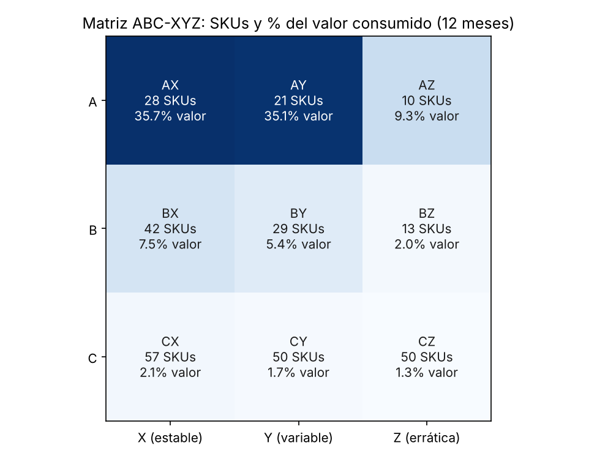

# Caso 01 · Clasificación ABC-XYZ de inventarios

**Herramientas:** SQL Server · Python (pandas, matplotlib) · Power BI (DAX)

## Problema de negocio
Una distribuidora farmacéutica y de consumo en Lima gestiona 300 SKUs con la misma política de reposición para todos. Resultado: quiebres en productos críticos y capital inmovilizado en productos que casi no rotan.

**Objetivo:** segmentar el portafolio por **valor** (ABC) y por **predictibilidad de la demanda** (XYZ) para asignar a cada grupo una política de inventario distinta, y cuantificar el stock en exceso.

## Datos
Datos **sintéticos** generados con `python/00_generar_datos.py` (no corresponden a ninguna empresa real):

| Archivo | Contenido | Filas |
|---|---|---|
| `data/raw/products.csv` | Maestro de materiales: familia, costo, proveedor, lead time | 300 |
| `data/raw/monthly_consumption.csv` | Consumo mensual por SKU, nov-2024 a oct-2026 | 7,200 |
| `data/raw/current_stock.csv` | Stock al 31-oct-2026 | 300 |

## Metodología
1. **ABC** por valor consumido en los últimos 12 meses (cantidad × costo unitario): A = primer 80 % del valor acumulado, B = hasta 95 %, C = resto.
2. **XYZ** por coeficiente de variación mensual (CV = desviación estándar / promedio): X ≤ 0.5, Y ≤ 1.0, Z > 1.0.
3. **Cobertura** = stock actual / consumo diario promedio. Menos de 15 días = riesgo de quiebre; más de 120 días = sobrestock; stock sin consumo en 12 meses = sin movimiento.
4. **Política sugerida** para cada una de las 9 celdas de la matriz.

La clasificación se implementó dos veces, en SQL (`sql/02_abc_xyz.sql`, con funciones de ventana) y en Python (`python/01_abc_xyz.py`), y ambas coinciden en el 100 % de los SKUs.

## Resultados



- **59 SKUs (20 %) concentran el 80 % del valor consumido**: es donde debe ir el esfuerzo de planificación.
- **AX y AY** (49 SKUs, ~71 % del valor) son demanda estable o estacional: candidatos a reposición automática con forecast.
- **AZ** (10 SKUs, ~9 % del valor) es la celda más riesgosa: alto valor con demanda errática. Requiere acuerdos con proveedores y seguimiento cercano.
- **CZ** (50 SKUs, solo 1.3 % del valor): candidatos a comprar bajo pedido o descontinuar.
- **S/ 1.9 millones en stock en exceso**: S/ 1.1 M en 18 SKUs sin movimiento y S/ 0.8 M por encima de 120 días de cobertura en 29 SKUs.
- **23 SKUs en riesgo de quiebre** (menos de 15 días de cobertura).

<!-- Agrega aquí la captura del dashboard:  -->

## Recomendaciones
1. Revisión semanal y stock de seguridad calculado para la clase A; revisión mensual para la C.
2. Plan de liquidación o redistribución para los SKUs sin movimiento, empezando por los de mayor valor (`sql/03_consultas_negocio.sql`, P4).
3. Para AZ: compra contra pedido o consignación negociada con el proveedor.
4. Siguiente paso: calcular stock de seguridad y punto de reorden por segmento (Caso 02).

## Cómo reproducirlo
```bash
pip install pandas matplotlib
python python/00_generar_datos.py   # genera data/raw/
python python/01_abc_xyz.py         # genera data/processed/ y docs/matriz_abc_xyz.png
```
SQL: ejecutar en orden `sql/01_crear_tablas.sql`, `02_abc_xyz.sql` y `03_consultas_negocio.sql`.
Power BI: ver `powerbi/medidas_dax.md`.
